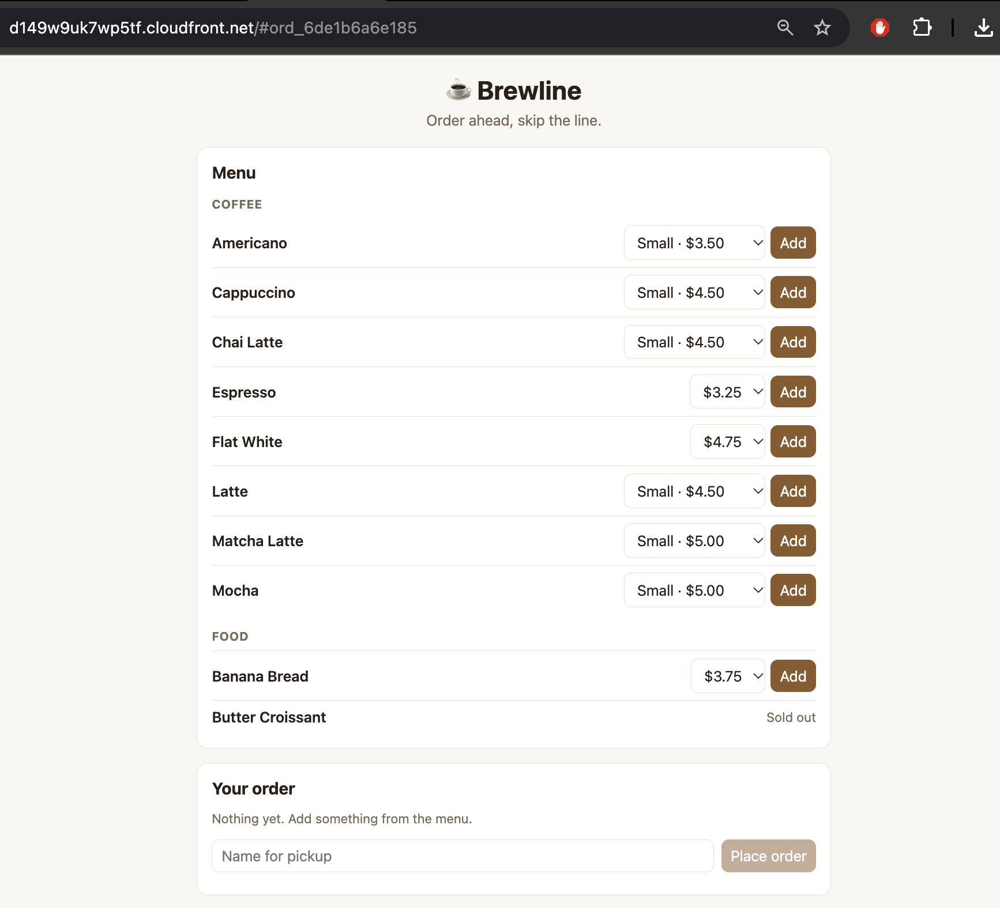
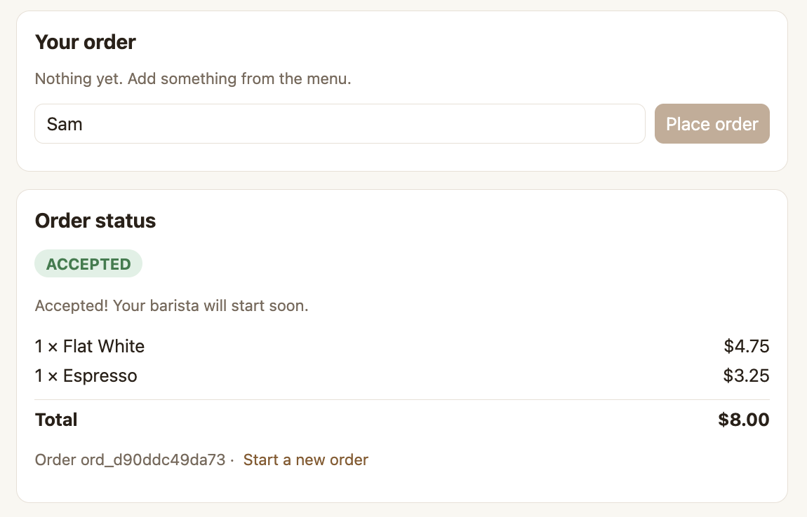
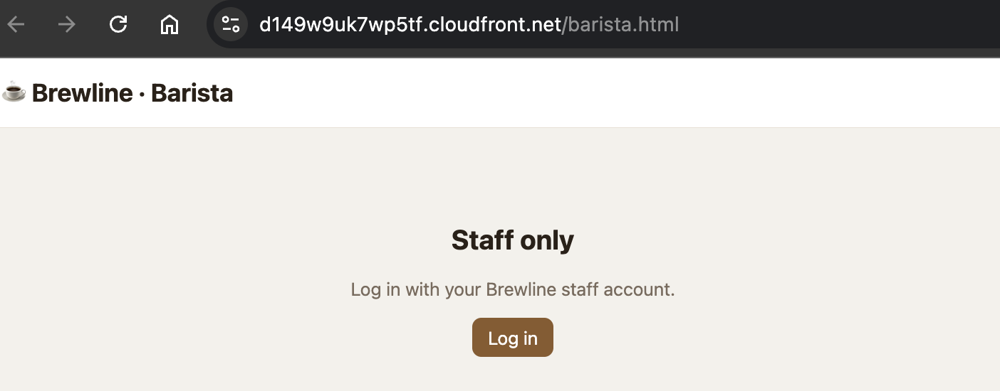
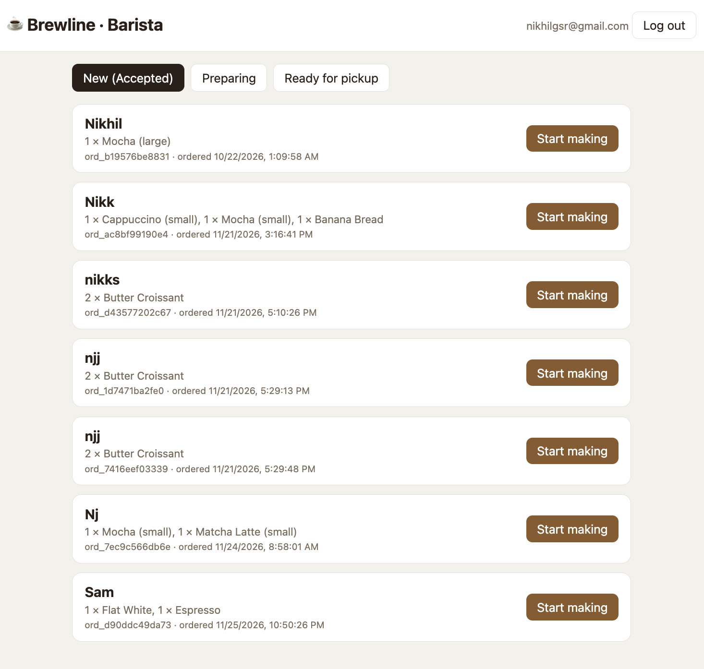
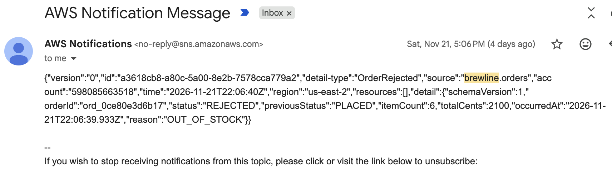
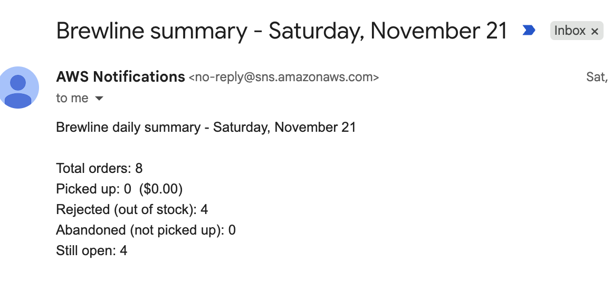
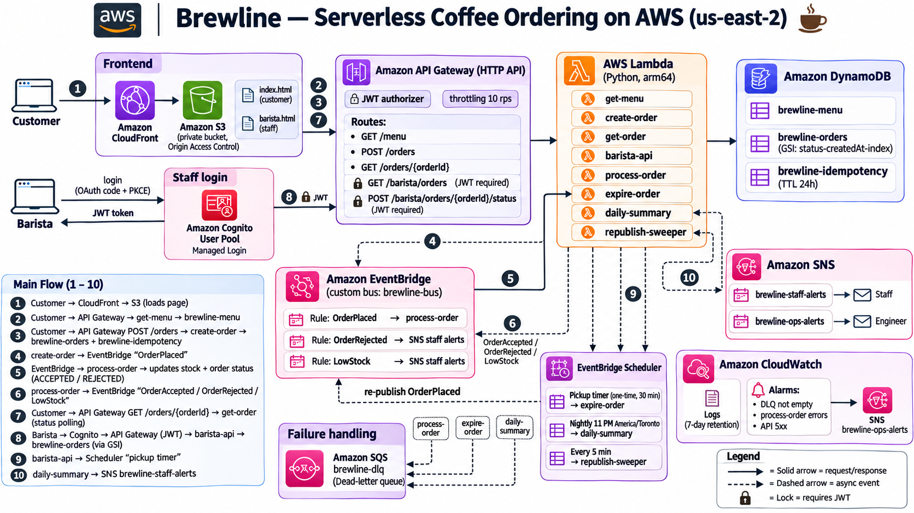

# ☕ Brewline - Serverless Coffee Ordering on AWS

An order-ahead coffee app built **fully serverless** on AWS: customers browse the menu, place an order and watch its status live; baristas log in to a protected dashboard to work the queue. Behind the scenes, orders are processed **asynchronously** with EventBridge, stock is reserved with **DynamoDB transactions**, and failures are caught by **dead-letter queues, a sweeper and CloudWatch alarms**.

> Built hands-on in the AWS Console (region `us-east-2`) as a portfolio project, designed to stay within the AWS free tier.


---

## 📸 Demo

| Customer — menu & order | Customer — live status |
|---|---|
|  |  |

| Barista — Cognito login | Barista — order queue |
|---|---|
|  |  |

| Staff alert email (SNS) | CloudWatch alarm email |
|---|---|
|  |  |

<!-- Add more screenshots to docs/screenshots/ and reference them here -->

---

## 🏗️ Architecture



| Layer | Services |
|---|---|
| Frontend | **S3** (private bucket) + **CloudFront** with Origin Access Control |
| API | **API Gateway HTTP API** — CORS, throttling (10 rps / burst 20), **JWT authorizer** |
| Auth | **Cognito User Pool** with Managed Login (OAuth 2.0 authorization code + PKCE) |
| Compute | **8 Lambda functions** (Python, arm64), one least-privilege role each |
| Data | **DynamoDB** — 3 tables + 1 GSI, TTL, conditional writes, transactions |
| Events | **EventBridge** custom bus + rules, **EventBridge Scheduler** (one-time & recurring) |
| Notifications | **SNS** — staff alerts and engineering (ops) alerts |
| Reliability | **SQS** dead-letter queue, Lambda on-failure destinations, republish sweeper |
| Observability | **CloudWatch** Logs (7-day retention) + alarms |

---

## 🔄 How it works

### 1. Customer places an order
```
Browser ──POST /orders──► API Gateway ──► create-order ──► DynamoDB (status: PLACED)
                                              │
                                              └──► EventBridge "OrderPlaced" ──► process-order
                                                                                    ├─ stock OK  → ACCEPTED (stock reserved)
                                                                                    ├─ low stock → LowStock event → 📧 staff
                                                                                    └─ no stock  → REJECTED   → 📧 staff
Browser ──GET /orders/{id} every 3 s──► get-order  (status polling)
```
The customer gets an answer in milliseconds; stock checking happens in the background.

### 2. Barista works the queue
```
Barista ──► Cognito Managed Login ──► JWT
        ──GET /barista/orders?status=ACCEPTED + JWT──► API Gateway (JWT check) ──► barista-api ──► GSI query (oldest first)
        ──POST /barista/orders/{id}/status──► ACCEPTED → PREPARING → READY → PICKED_UP
```
When an order becomes **READY**, a one-time Scheduler timer is created; if it isn't picked up in 30 minutes, `expire-order` marks it **ABANDONED**.

### 3. Background jobs
| Schedule | Lambda | Purpose |
|---|---|---|
| One-time, +30 min after READY | `expire-order` | READY → ABANDONED |
| Nightly 11 PM `America/Toronto` | `daily-summary` | Totals emailed to staff |
| Every 5 minutes | `republish-sweeper` | Re-publishes orders whose event was never sent |

---

## 📡 API

| Method & path | Auth | Description |
|---|---|---|
| `GET /menu` | public | Active menu items (hidden items and stock counts never exposed) |
| `POST /orders` | public + `Idempotency-Key` header | Create an order (server-side pricing) |
| `GET /orders/{orderId}` | public | Order status |
| `GET /barista/orders?status=` | **JWT** | Queue for one status, oldest first |
| `POST /barista/orders/{orderId}/status` | **JWT** | `{"action": "START" \| "READY" \| "PICKED_UP"}` |

Error format: `{"error": {"code": "...", "message": "..."}}` — codes: `VALIDATION_ERROR`, `UNKNOWN_ITEM`, `IDEMPOTENCY_CONFLICT`, `ORDER_NOT_FOUND`, `INVALID_TRANSITION`, `INTERNAL_ERROR`.

---

## 🗄️ Data model (DynamoDB)

| Table | Key | Notes |
|---|---|---|
| `brewline-menu` | `itemId` | Prices in **integer cents**, `stock`, `lowStockAt`, `active` |
| `brewline-orders` | `orderId` | GSI **`status-createdAt-index`** (PK `status`, SK `createdAt`) for the barista queue & daily summary |
| `brewline-idempotency` | `idempotencyKey` | **TTL** on `expiresAt` — tickets delete themselves after 24 h |

Provisioned capacity with auto scaling off, to stay inside the free tier.

---

## 🧠 Key engineering decisions

**Idempotency (no double coffee).** The browser sends an `Idempotency-Key`. `create-order` claims it with a single **conditional write** (`attribute_not_exists`), so two simultaneous taps can't both win. A repeat with the same key returns the original order (`Idempotent-Replay: true`); the same key with a *different* order body returns `409`.

**Server-side pricing.** The client only sends item IDs and quantities; prices always come from DynamoDB.

**Event-driven processing.** `create-order` doesn't know who listens — it publishes `OrderPlaced`. Adding staff alerts later required **no changes** to it (decoupling).

**All-or-nothing stock reservation.** `process-order` uses `TransactWriteItems` to decrement every item (`stock >= qty`) **and** mark the order ACCEPTED in one step — no half-reserved orders.

**Order state machine.** Every status change is a conditional update on the expected previous status, so you can't jump from PLACED to READY, and two baristas can't double-move an order (`409 INVALID_TRANSITION`).

**Idempotent consumers.** EventBridge, Scheduler and retries deliver *at least once*. Every consumer checks the current state first, so duplicates are harmless.

**Check `FailedEntryCount`.** `PutEvents` can partially fail without throwing; the code checks it and leaves `eventPublished = false` so the sweeper can recover.

---

## 🛡️ Failure handling

| Failure | Caught by | Result |
|---|---|---|
| Lambda code crashes (bug, DynamoDB error) | Lambda async retries (2) → **on-failure destination** | Event + error saved in `brewline-dlq` |
| EventBridge can't reach the target | Rule retry policy → **rule DLQ** | Event saved in `brewline-dlq` |
| Order saved but event never published | **republish-sweeper** (every 5 min) | Event re-published |
| Order READY but never collected | **one-time Scheduler timer** | Marked ABANDONED |

**Tested on purpose:** I broke `process-order` (wrong table name), watched 3 attempts fail with growing back-off, found the event in the DLQ with `RetriesExhausted` and the full stack trace, fixed it, **replayed** the event, and the order was accepted. The sweeper also rescued 3 orders that had been stuck since before publishing existed.

---

## 🔔 Monitoring

CloudWatch alarms → SNS `brewline-ops-alerts` (email on **ALARM** and on **OK**):

| Alarm | Metric | Condition |
|---|---|---|
| `brewline-dlq-not-empty` | SQS `ApproximateNumberOfMessagesVisible` (Maximum) | > 0 |
| `brewline-process-order-errors` | Lambda `Errors` (Sum) | > 0 |
| `brewline-api-5xx` | API Gateway `5xx` (Sum) | > 0 |

Missing data is treated as *good* (a quiet queue is a healthy queue).

---

## 🔐 Security

- One IAM role per Lambda, scoped to only the actions it needs ([`iam/`](iam/))
- Private S3 bucket, readable only by CloudFront (OAC)
- Barista routes protected by a **JWT authorizer** at API Gateway — unauthenticated requests get `401` before any Lambda runs
- Cognito SPA client (no client secret) with **PKCE**; tokens never travel in the URL
- CORS limited to the CloudFront origin; API throttling enabled
- Customers never give an email; events carry order IDs, not personal data
- `iam:PassRole` limited with `iam:PassedToService = scheduler.amazonaws.com`

---

## 💰 Cost

Designed to run within the AWS free tier: Lambda, DynamoDB (provisioned 25/25 RCU/WCU), SNS, SQS, CloudFront, Cognito (Essentials) and 3 CloudWatch alarms. A **$1 budget alert** was set before building anything.

---

## 📁 Repository structure

```
brewline/
├── README.md
├── docs/
│   ├── architecture.png
│   └── screenshots/
├── frontend/
│   ├── index.html          # customer page (menu, order, live status)
│   └── barista.html        # barista dashboard (Cognito login + queue)
├── lambdas/
│   ├── get-menu/           create-order/      get-order/
│   ├── process-order/      barista-api/       expire-order/
│   └── daily-summary/      republish-sweeper/
├── iam/                    # one inline policy per Lambda + scheduler role + DLQ policy
└── seed/
    └── menu.json           # 11 menu items (batch-write-item format)
```

---

## 🚀 Recreate it

1. **Budget:** create a monthly cost budget with an email alert.
2. **DynamoDB:** create the 3 tables (+ GSI and TTL), then seed:
   `aws dynamodb batch-write-item --request-items file://seed/menu.json`
3. **Lambdas:** create each function (Python, arm64) with its own role (`AWSLambdaBasicExecutionRole` + the matching file in `iam/`), and set its environment variables (`MENU_TABLE`, `ORDERS_TABLE`, `IDEMPOTENCY_TABLE`, `EVENT_BUS_NAME`, `STATUS_INDEX`, `TOPIC_ARN`, `EXPIRE_FUNCTION_ARN`, `SCHEDULER_ROLE_ARN`, `PICKUP_TIMEOUT_MINUTES`).
4. **EventBridge:** create a *Classic* custom bus `brewline-bus` and rules for `OrderPlaced`, `OrderRejected` and `LowStock`.
5. **API Gateway:** HTTP API with the 5 routes, CORS for your CloudFront origin, throttling, and a JWT authorizer (Cognito issuer + client ID) on the barista routes.
6. **Cognito:** user pool + SPA app client with Managed Login; callback URL = `https://<your-distribution>/barista.html`.
7. **Frontend:** replace the `YOUR_...` placeholders in `frontend/*.html`, upload to S3, serve via CloudFront (OAC).
8. **Reliability & monitoring:** SQS `brewline-dlq` (14-day retention), on-failure destinations, Scheduler schedules, SNS topics and CloudWatch alarms.

---

## 🔭 What I'd improve for production

- **Infrastructure as Code** — rebuild with Terraform (next project)
- Resource-scoped IAM ARNs instead of `"*"` (see [`iam/README.md`](iam/README.md)), and a minimal EventBridge rule role instead of the console default
- **Transactional outbox** (DynamoDB Streams / EventBridge Pipes) instead of publish-after-write + sweeper
- Sparse GSI for the sweeper instead of a Scan
- **WAF** rate-based rules for per-IP abuse protection
- **X-Ray** tracing and a CloudWatch dashboard
- Push updates (WebSockets) instead of polling; payments; multi-region with DynamoDB global tables

---

## 📚 What I learned

- Designing DynamoDB tables around **access patterns** (keys, GSIs, TTL) instead of queries
- Why **idempotency**, conditional writes and idempotent consumers matter in distributed systems
- **Event-driven** decoupling with EventBridge, and the difference between *delivery* failures and *processing* failures
- Debugging real issues: IAM `AccessDenied` (reading the role name first), CORS, API Gateway vs Lambda `404`s, and the new EventBridge bus type
- Running a full incident cycle: **break → alert → investigate logs → fix → replay → resolve**

---

**Author:** Nikhil Jassal · [LinkedIn](https://linkedin.com/in/nikhiljassal07)
